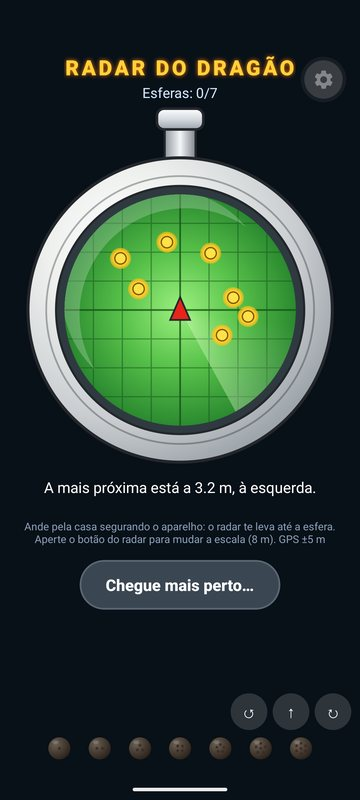
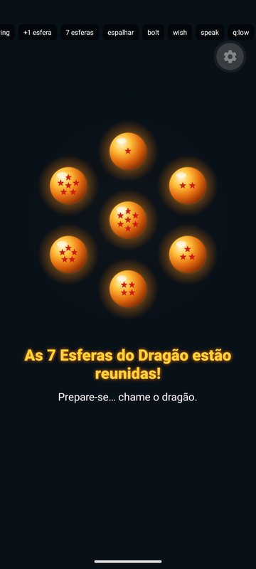
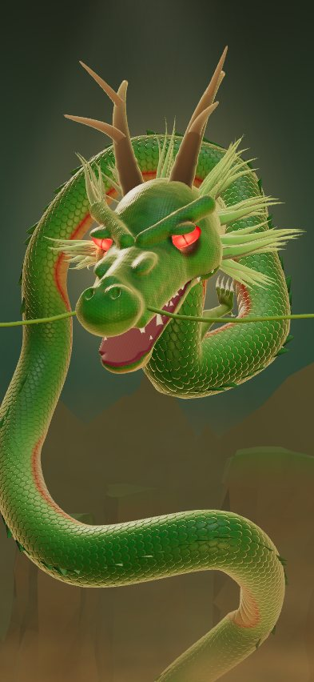

# Shenlong 🐉

Experiência imersiva de celular (feita para uma criança de 5 anos): o app vira o **Radar do Dragão**, a criança procura as **7 Esferas do Dragão** escondidas pela casa, pega cada uma com a câmera e, com as sete reunidas, diz **"Shenlong, apareça!"**. O dragão surge em 3D e conversa por voz; depois do desejo, as esferas se espalham de novo.

   

Plano e decisões: [`docs/PLANO.md`](docs/PLANO.md) · visual: [`docs/VISUAL.md`](docs/VISUAL.md) · roteiro de testes: [`docs/TESTES.md`](docs/TESTES.md).

```
mobile/   app Expo SDK 57 (Expo Go): radar + câmera (caçada), Shenlong 3D (three.js + expo-gl), efeitos em Skia
tools/    dragon/ (escultura → GLB) · viewer/ (renders de inspeção e ícone) · voice/ (Piper + Whisper locais)
server/   backend Hono/Node: /api/stt, /api/chat (NDJSON por frase), /api/tts — as chaves ficam aqui
```

## Fluxo
1. **Toque para começar** (libera áudio e microfone).
2. **Radar do Dragão**: 7 esferas espalhadas num raio de ~5,6 m (≈ 100 m², cabe dentro de casa). Ande com o celular; o radar bipa mais rápido quanto mais perto. O botão no topo do radar muda a escala (4/8/16 m).
3. Perto de uma esfera (≤ 2,2 m): **Procurar com a câmera** → a esfera aparece no ambiente, no chão, na direção real dela → toque para pegar.
4. Com as 7: apresentação das esferas e o app vai sozinho ao **altar, já ouvindo**: "Shenlong, apareça!".
5. Invocação, conversa por voz, até 3 desejos. Depois da despedida, as esferas **se espalham de novo** ao redor de onde a criança está.

**Como a posição funciona dentro de casa:** o GPS do celular erra de 5 a 15 m em ambiente fechado, mais que a área inteira da caçada. Por isso a posição vem dos **passos** (acelerômetro) na direção do aparelho (giroscópio + bússola); o GPS ancora a caçada no lugar e só corrige derivas grandes. Aparelhos **sem giroscópio/bússola** (comuns em tablets de entrada) entram no **modo guiado**: qualquer passo aproxima a esfera mais próxima e o radar aponta para ela. A "realidade aumentada" é por sensores (rumo + inclinação), que funciona no Expo Go; ancorar em superfícies (ARKit/ARCore) exigiria um build próprio.

## Rodar no celular (Expo Go)

```bash
make install       # dependências + cria server/.env
make voice-setup   # 1ª vez: ouvir (Whisper) e voz (Piper) locais e grátis
make up            # backend (:8787) + Expo; leia o QR com o Expo Go
```
- Celular e PC na **mesma rede Wi‑Fi**. Se não conectar: `sudo ufw allow 8081,8787/tcp`.
- Sem chave nenhuma, tudo funciona: ouvir e falar locais, conversa por regras. Com `OPENAI_API_KEY` em `server/.env`, a conversa vira IA de verdade.
- O app descobre o servidor sozinho (IP do Metro); no emulador Android também tenta `10.0.2.2`. A barra de diagnóstico (só em dev) mostra `servidor ✓ ouvir ✓ voz ✓ conversa ✓`.
- `/debug` (`shenlong://debug`): pula para qualquer fase; botões "+1 esfera", "7 esferas" e "espalhar" para testar a caçada. Em dev, o radar e a câmera têm um controle ↺ ↑ ↻ para simular passos e giros.

## Instalar sem loja
- **Android (tablet)**: `make mobile-build-android ENV=preview` gera um **APK** pelo EAS; abra o link no tablet e instale (permitir "fontes desconhecidas"). Não precisa da Play Store.
- **iPhone**: pelo Expo Go (desenvolvimento) ou, para um app instalado, conta Apple Developer (US$ 99/ano) + `make mobile-build-ios ENV=preview` (instalação *ad hoc* no aparelho cadastrado) ou TestFlight. Sem a conta paga, só via Xcode num Mac (expira em 7 dias).
- **Antes do build:** no app instalado não há Metro para descobrir o PC, então o endereço do servidor vem de `EXPO_PUBLIC_API_URL` em `mobile/eas.json` (hoje um exemplo). Aponte para um servidor hospedado (HTTPS) ou para o PC de casa; neste caso o Android precisa liberar HTTP na rede local.

## Visual
3D em tempo real: modelo esculpido proceduralmente (`make dragon-build`), corpo deformado na GPU, escamas, olhos acesos, bigodes com física, cenário com rochas e montanhas. `make dragon-shot` / `make dragon-viewer` renderizam a cena no navegador; `make icon` regera os ícones. Histórico e decisões: [`docs/VISUAL.md`](docs/VISUAL.md).

## Voz
- Sem chave: reconhecimento **Whisper** local e voz **Piper** pt-BR com efeito "voz de dragão" (ffmpeg: grave ~90 Hz, reverb). Conversa por regras (entende "eu quero …", concede, pergunta o próximo desejo, se despede).
- Com `OPENAI_API_KEY`: reconhecimento, voz e conversa da OpenAI (uma chave basta), com o mesmo efeito na voz.
- Sons do radar, das esferas e da invocação são **sintetizados por código** (`cd mobile && npm run gen:sfx`). Para usar outro som de radar, troque `mobile/assets/sfx/radar.wav` (mesmo nome).

## Testes
`cd mobile && npm test` (máquina de estados, invocação, geometria da caçada, orientação dos sensores, estrelas das esferas, GLB) · `cd server && npm test` · `npx tsc --noEmit` nos dois.

## Estado atual
Testado no emulador Android (Expo Go): caçada completa (radar → câmera → 7 esferas → altar ouvindo sozinho), invocação e Shenlong 3D, reembaralhamento depois do desejo, servidor local alcançado. A conferir em aparelho real: passos/bússola dentro de casa (iPhone 16 e tablet), latência da voz, desempenho do 3D no tablet.
